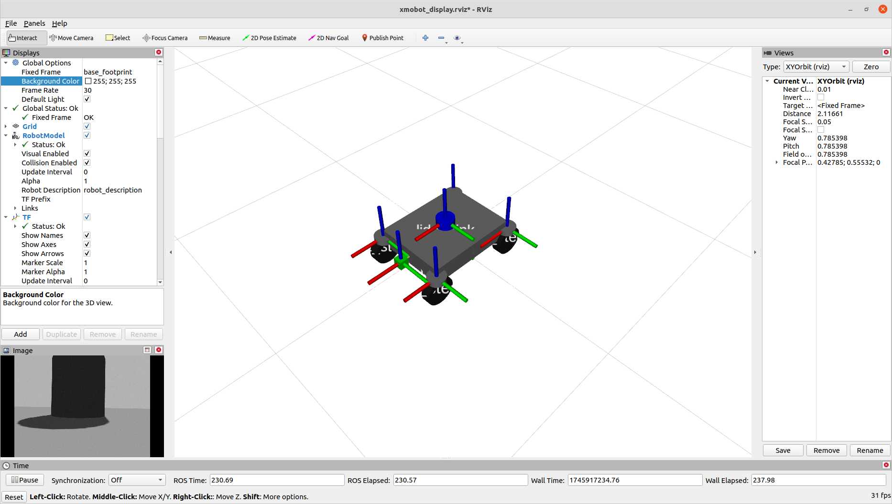
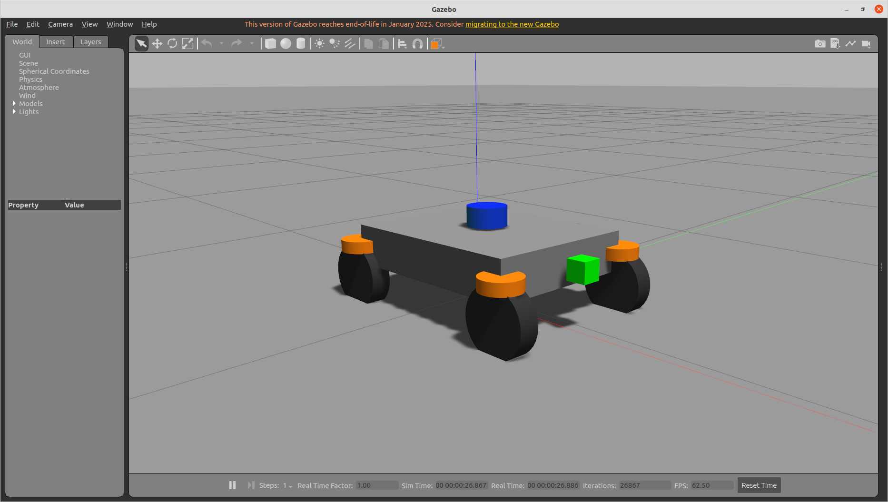
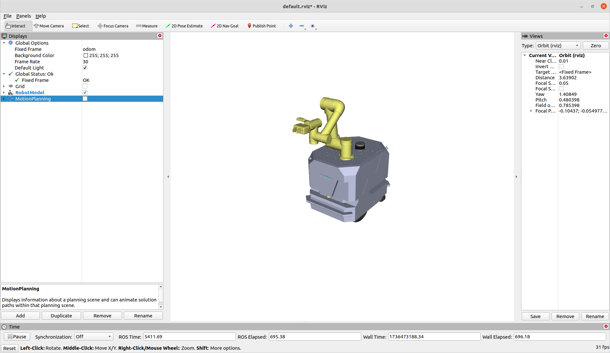
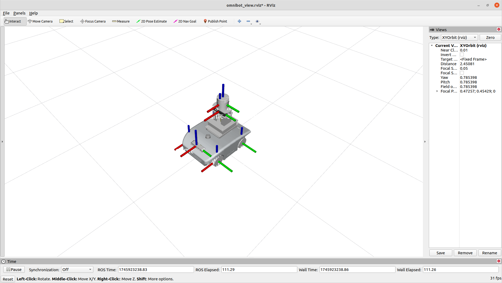
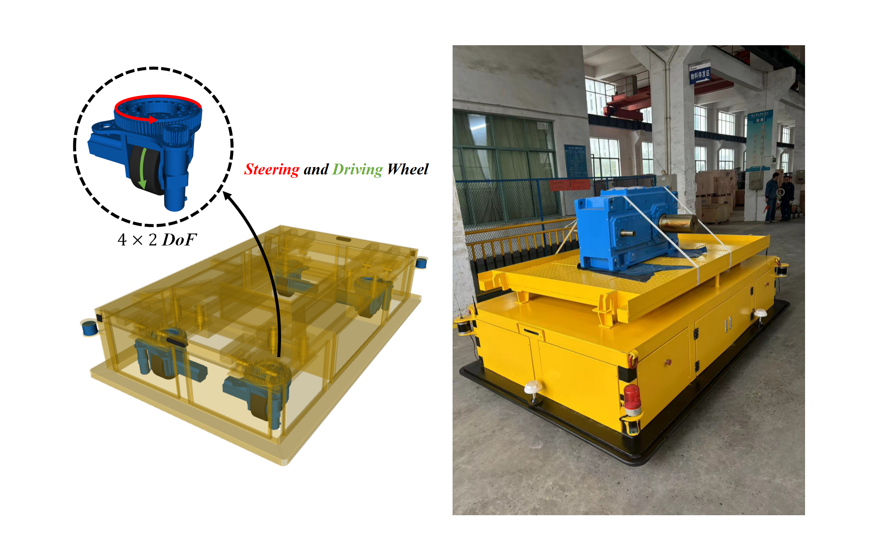

<p align="center">
  
</p>

# Xmobot

**ROS 2 Foxy** (`ros2`) · [ROS 1 Noetic edition](https://github.com/YeatsWang/xmobot/tree/ros)

Xmobot is a flexible, modular mobile robot platform for SLAM, path planning, and navigation research benchmarking across diverse drive types, including differential, Ackermann, Mecanum (omnidirectional drives), and four-wheel independent steering with driving (4WISD).

## Interactive Xmobot configurator

[Open Xmobot Viz](https://yeatswang.github.io/xmobot_viz/#geometry) to compare rotation, translation and turning. Select a drivetrain, set the chassis dimensions, wheels and arm layout, then choose **Export Xmobot URDF**.

## Quick start with ROS 2 Foxy

On Ubuntu 20.04 with ROS 2 Foxy, colcon and rosdep installed, run the following in Bash.

```bash
source /opt/ros/foxy/setup.bash
mkdir -p ~/ros2_ws/src
cd ~/ros2_ws/src
git clone --branch ros2 https://github.com/YeatsWang/xmobot.git
cd ~/ros2_ws
rosdep install --from-paths src --ignore-src -r -y
colcon build --packages-select xmobot
source install/setup.bash
```

### Preview a model in RViz2

Open a single-arm model, or point RViz2 at the URDF you exported from the browser.

```bash
ros2 launch xmobot display_launch.py arm_count:=1
ros2 launch xmobot display_launch.py urdf_file:="$HOME/Downloads/xmobot-4wis-0arm.urdf"
```

Use the path to your downloaded file in the second command. The exported URDF already contains your chosen dimensions.



### Load the model in Gazebo Classic

Pass the same mechanical settings to the ROS 2 launcher to build the model with its Gazebo plugins. This example loads a longer chassis with rear-wheel Ackermann steering and a single arm.

```bash
ros2 launch xmobot gazebo_launch.py drive_type:=ackermann_rear robot_length:=0.70 wheel_separation_x:=0.58 arm_count:=1
```

Gazebo publishes simulated joint positions through the joint state broadcaster. You can inspect the active controllers in a second sourced terminal.

```bash
ros2 service call /controller_manager/list_controllers controller_manager_msgs/srv/ListControllers '{}'
```

The Mecanum model uses cylindrical wheel collisions. Reproducing its sideways motion in Gazebo requires a roller-contact model or equivalent contact dynamics.



### Mechanical parameters

Both launchers accept these settings. Lengths are in metres.

| Parameter | Default | Meaning |
| --- | --- | --- |
| `drive_type` | `4wis` | Four-wheel independent steering and driving. Also accepts `diff_drive`, `mecanum`, `ackermann_front` and `ackermann_rear`. |
| `robot_length`, `robot_width`, `robot_height` | 0.50, 0.40, 0.10 | Chassis length, width and thickness |
| `wheel_radius`, `wheel_width` | 0.08, 0.05 | Wheel radius and tread width |
| `wheel_separation_x`, `wheel_separation_y` | 0.50, 0.40 | Wheelbase and track width |
| `arm_count` | 2 | Install zero, one or two arms. `use_arms:=false` disables both. |
| `arm_mount_x` | `auto` | Fore–aft mount position relative to the chassis centre. A single arm defaults to halfway between the central LiDAR and the rear edge, subject to clearance. |
| `arm_spacing` | `auto` | Centre-to-centre distance between dual arm mounts |

Wheel centres follow the wheel radius to keep the tyres on the ground. LiDAR and arm bases follow the top deck as thickness changes. The front camera follows the centre of the front face as length changes.

## Contribution
We welcome contributions!
If you want to:
- Improve mechanical design and model fidelity
- Solve parameters tuning issues (PID + physics parameters optimization)
- Add new sensor modules (3D LiDAR or Depth camera)

Please feel free to submit pull requests or open issues!

---

## Extended Robot Models based on Xmobot
CsuBot: Mobile robot (diff_drive) with manipulator


OmniBot: Mobile robot with Mecanum wheels (The robot system is designed by Prof. Degang Xu research group in Automation School of Central South University)


CsuAmr: Four-Wheel Independent Steering and Driving mobile robot (The robot system is designed by Prof. Degang Xu research group in Automation School of Central South University)


---

## Citation

[Download both BibTeX entries](xmobot.bib), or copy the entry for the work you use.

### Xmobot platform and robotics education

[IEEE Xplore · IEEE Transactions on Learning Technologies](https://ieeexplore.ieee.org/document/11475163)

```bibtex
@article{wang2026xmobot,
  author = {Wang, Yizhi and Wang, Minjuan and Xu, Degang and Lee, John Chi-Kin and Xie, Yongfang},
  title = {{Xmobot}: Enabling Rapid Build-and-Train Robotics Education With Agentic AI},
  journal = {IEEE Transactions on Learning Technologies},
  volume = {19},
  pages = {376--387},
  year = {2026},
  doi = {10.1109/TLT.2026.3681123},
  url = {https://ieeexplore.ieee.org/document/11475163}
}
```

### 4WISD kinematic controller

[IEEE Xplore · China Automation Congress](https://ieeexplore.ieee.org/document/11487174)

```bibtex
@inproceedings{wang2025universal,
  author = {Wang, Yizhi and Xu, Degang and Xie, Yongfang},
  title = {Universal Multi-Mode Kinematic Controller for Four-Wheel Independent Steering and Driving Mobile Robots},
  booktitle = {2025 China Automation Congress (CAC)},
  year = {2025},
  pages = {4491--4496},
  doi = {10.1109/CAC67268.2025.11487174},
  url = {https://ieeexplore.ieee.org/document/11487174}
}
```

## License
This project is licensed under the MIT License.
